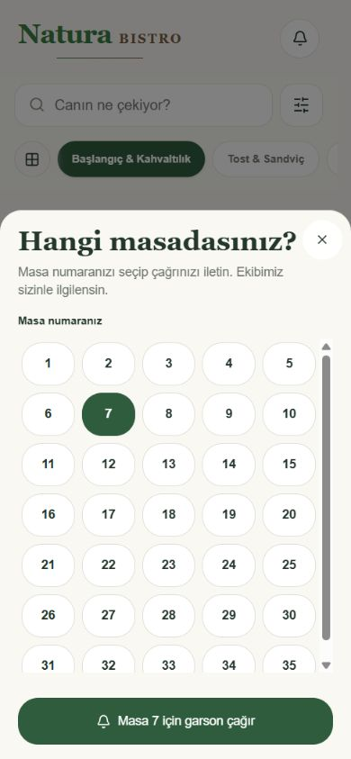

# Natura Menü 🌿

Natura Bistro için mobil öncelikli dijital menü ve tek yöneticili işletme paneli. **Next.js 16 · React 19 · TypeScript · SQLite · Tailwind CSS 4 · shadcn/ui**.

- Natura adı ve mevcut tipografik logosu korunur.
- İsteğe bağlı kampanya banner’ı: menüden ürün/porsiyon seçimi, otomatik görsel ve üstü çizili normal fiyat, belirgin kampanya fiyatı, canlı önizleme ve aç/kapat kontrolü.
- Telefonda yatay kategori geçişi, arama, mevcut ürün filtresi ve alttan açılan ürün ayrıntıları.
- Masa numarası seçerek garson çağırma; masaya özel QR kod gerekmez. Yönetim panelinde periyodik kontrol ve kullanıcı tarafından açılan ses.
- Ürün/kategori yönetimi, yukarı/aşağı sıralama, toplu fiyat güncelleme, stok/görünürlük, etiket, alerjen ve porsiyon seçenekleri.
- Değiştirilebilir 1–200 masa, yazdırılabilir QR kodları ve SVG indirme.
- Yüklemelerde Sharp ile 1000/480 px WebP; SQLite ve yüklenen fotoğraflar aynı kalıcı volume’da.
- İmzalı 12 saatlik yönetici oturumu, HttpOnly/Secure/SameSite çerezi, kaynak doğrulaması ve kalıcı istek sınırları.

## Dokploy’da çalıştırma

**[Adım adım Türkçe Dokploy kurulumu →](docs/DOKPLOY.md)**

Alan adı: `natura.beyoglumutfagi.com` · Yönetim: `/admin`.

## Önizleme





## Yerel geliştirme

Node.js **24+** ve pnpm **11.25.0** kullanın:

```sh
pnpm install --frozen-lockfile
cp .env.example .env.local
# .env.local: APP_URL=http://localhost:3000, DATA_DIR=./data
# ADMIN_PASSWORD ve SESSION_SECRET değerlerini değiştirin.
pnpm dev
```

`SESSION_SECRET` için en az 32 karakterlik rastgele bir değer, `ADMIN_PASSWORD` için en az 12 karakterlik benzersiz şifre belirleyin. Ortam dosyaları ve veritabanı Git’e eklenmez.

```sh
pnpm typecheck
pnpm test
pnpm build
```

## Kaynak içerik ve görseller

Eski proje: [isousluer/natura-qr-menu](https://github.com/isousluer/natura-qr-menu). Canlı menüden alınan ilk içerik `src/data/menu.json` içinde yer alır; ilk veritabanı kurulumunda bir kez kullanılır. Kaynakta görünen **9 kategori ve bu kategorilere bağlı 95 ürün**, görünürlük durumlarıyla alınmıştır. Kaynak menü açıklamalarında olmayan alerjen ve porsiyon bilgileri uydurulmadı. Kaynakta kapalı başka kategoriler varsa bunlar herkese açık menüden doğrulanamaz.

İçe aktarma ölçümleri: `src/data/import-report.json`. Mevcut 96 fotoğraf için ana ve küçük sürümler üretildi. Fotoğrafı bulunmayan sekiz ürün için yapay zekâ ile temsili görseller oluşturuldu ve menüde işaretlendi. İşletme kendi fotoğraflarını panelden yükleyebilir.

Üretilen görsellerin ortak tarifi: ürün adına uygun Türk bistro sunumu, kırık beyaz seramik tabak, sıcak doğal ışık, krem masa ve hafif zeytin yeşili kumaş; 45 derece gerçekçi yemek fotoğrafı; insan, yazı, marka ve filigran yok. Her ürün ayrı oluşturuldu: serpme kahvaltı; sebzeli karışık, kaşarlı, sebzeli kaşarlı, kavurmalı ve sucuklu bazlama tost; köz patlıcan salata; kaymaklı çikolatalı katmer. Yerleşik görsel üretimi kullanıldı. Son WebP dosyaları `public/menu/generated-1.webp`–`generated-8.webp` ve küçük sürümleridir.

Orijinal görüntü dosyaları yeni yüklemelerde saklanmaz. WebP kalite ayarları 84/82’dir; dosya boyutu fotoğraf içeriğine bağlıdır. Tüm ürünlerin görselleri yerel servis edilir; Supabase’e çalışma zamanı bağımlılığı yoktur.

## İşletim notları

Tek örnek / tek sunucu kullanın. Uygulama menü görüntüleme ve garson çağırma için kullanılır; çevrimiçi sipariş ve ödeme sunulmaz. Garson çağrılarını almak için panel açık ve bağlantılı olmalı; arka plan push bildirimi sunulmaz. Yedekleme ve geri yükleme için kurulum belgesine bakın.
