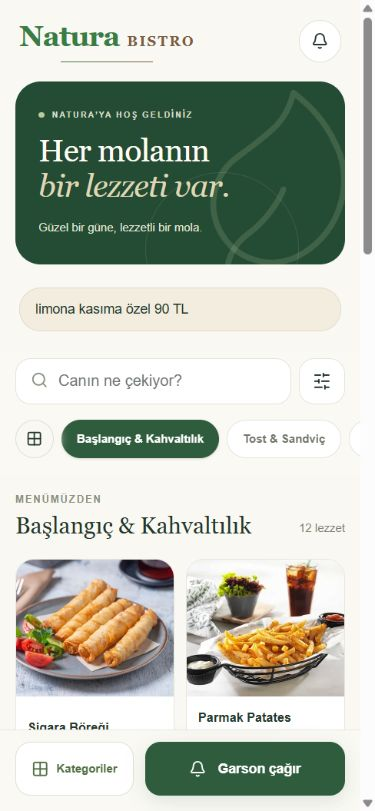
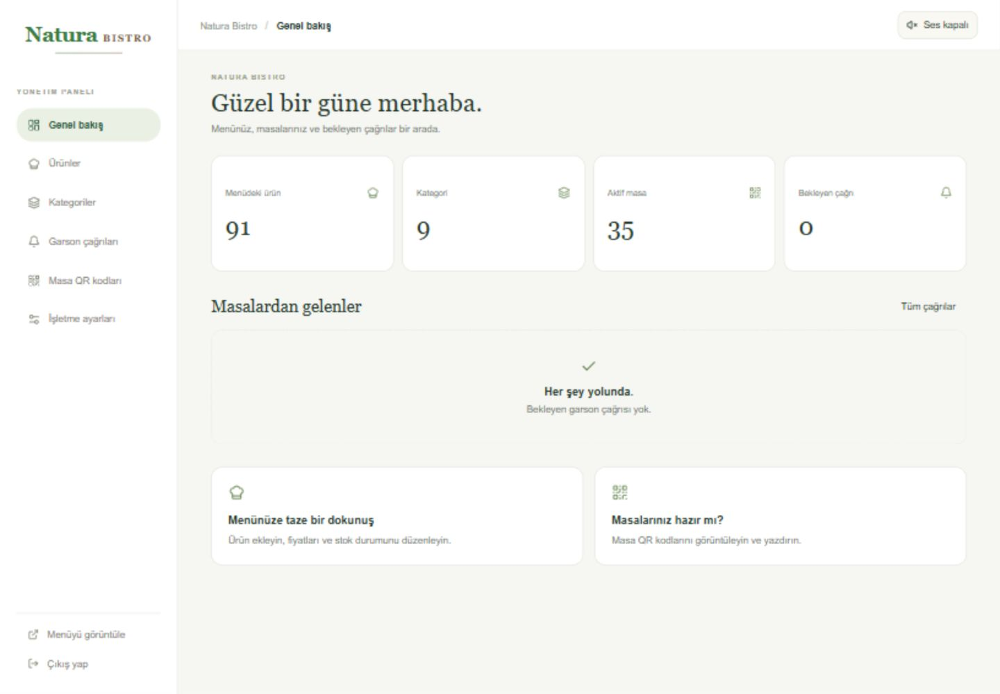

# Natura Menü 🌿

Natura Bistro için mobil öncelikli dijital menü ve tek yöneticili işletme paneli. **Next.js 16 · React 19 · TypeScript · SQLite · Tailwind CSS 4 · shadcn/ui**.

- Natura adı ve mevcut tipografik logosu korunur.
- Masada tam ekran sipariş: bağımsız kaydırılabilen görselli kategori ve ürün blokları, tek panelde adisyon ve ödeme; telefonda kategoriler, ürünler ve siparişler aynı anda görünür.
- Hesap adlı hızlı sipariş: masa seçmeden kasa satışı / paket servis; ödenmeyen hesapları Açık masalar içinde takip etme. Cari hesaplar, kapanan adisyonlar ve günlük kasa sol menüdedir.
- Masalar: varsayılan Açık Masalar görünümü, onayla etkinleşen masa/sipariş taslağı, tek satırda ürün adedi, ürün ve adet bazında veya tutarla ödeme; menüyle senkron sipariş, fiyat anlık görüntüsü, parçalı nakit/kredi kartı/yemek kartı ödemesi, kalan tutarı cariye aktarma, %10/%20 indirim, boş masaya taşıma veya dolu masayla birleştirme ve günlük kasa özeti.
- Cihazda 12 saatlik sipariş taslağı kurtarma; belirsiz ağ yanıtında işlem anahtarıyla kayıt kontrolü ve çift sipariş/ödeme/iade koruması.
- Nedenli ödeme türü düzeltme, parasal iade, yalnız yöneticinin düzenleyebildiği sabit açılış kasası ve kasa giriş/çıkışı. Kapanan adisyonu yeniden açma yalnız yöneticide. Yöneticiyle gün kapatma; cari dışı tamamlanmış satışların temizlenmesi, cari fişlerin korunması. [Gün kapatma rehberi](docs/GUN-KAPAT.md).
- Kullanıcı adı ve şifreyle ortak giriş; yönetici, kasiyer ve garson yetkileri. Kullanıcı adı değişiklikleri yöneticiye aittir. Yönetici giriş adı `beyoglumutfagi@gmail.com`, şifre mevcut `ADMIN_PASSWORD` veya panelde kaydedilmiş şifredir.
- Cari hesap hareketlerinden eski adisyonun ürün ve ödeme detaylarına erişim; cari tahsilat kaydı.
- Tek `/admin` yönetim ekranı; mobilde üç sütunlu ürün kartları, tek satırlık siparişler ve bağımsız kaydırılan bölümler. Müşterinin masa seçerek gönderdiği siparişler yönetimde onaylanır.
- Tarayıcı üzerinden adisyon yazdırma: masadaki Yazdır düğmesi yazdırma ekranını açar. Seçilen kağıda uyumlu otomatik düzen, A4 ve Possify 80 mm seçenekleri; ek program gerekmez. [Adisyon kullanım rehberi](docs/ADISYON.md).
- İsteğe bağlı kampanya banner’ı: menüden ürün/porsiyon seçimi, otomatik görsel ve üstü çizili normal fiyat, belirgin kampanya fiyatı, canlı önizleme ve aç/kapat kontrolü.
- Telefonda dikey açılır kategoriler: ilk yüklemede tümü kapalıdır; dokunulan kategori açılır, ürünler altında listelenir ve aşağı kaydırılarak gezilir. Ürünler tıklama veya detay penceresi olmadan, açıklamaları ve varsa tüm porsiyon fiyatlarıyla doğrudan listelenir.
- Masa numarası seçerek garson çağırma; masaya özel QR kod gerekmez. Yönetim panelinde periyodik kontrol ve kullanıcı tarafından açılan ses.
- Ürün/kategori yönetimi, yukarı/aşağı sıralama, toplu fiyat güncelleme, stok/görünürlük, etiket, alerjen ve porsiyon seçenekleri.
- Tek bir Menü yönetimi ekranında açılır kategoriler ve altlarında ürünler; kategori içinden ürün ekleme/düzenleme, kategoriye özel toplu fiyat güncelleme ve aramayla otomatik açılan sonuçlar.
- Kategori ve ürünlerde bağımsız **QR menüde göster/gizle** düğmesi: QR'de gizlenenler kasa, masa ve cari siparişlerinde kullanılabilir. Kategori gizliyse bütün alt ürünleri QR'de gizlenir; tekil ürün ayarları korunur. **Satışa açık** anahtarı ise hem kasa hem QR satışını yönetir. Gizli ürünün kampanya banner'ı da gösterilmez.
- Değiştirilebilir 1–200 masa; müşteri menüsünden masa seçerek garson çağrısı. Masa QR kodu oluşturma ve yazdırma ekranları kaldırıldı.
- Yüklemelerde Sharp ile 1000/480 px WebP; SQLite ve yüklenen fotoğraflar aynı kalıcı volume’da.
- İmzalı 12 saatlik yönetici oturumu, HttpOnly/Secure/SameSite çerezi, kaynak doğrulaması ve kalıcı istek sınırları.

## Dokploy’da çalıştırma

**[Adım adım Türkçe Dokploy kurulumu →](docs/DOKPLOY.md)**

Alan adı: `natura.beyoglumutfagi.com` · Yönetim: `/admin`.

## Önizleme






## Yerel geliştirme

Node.js **24+** ve pnpm **11.25.0** kullanın:

```sh
pnpm install --frozen-lockfile
cp .env.example .env.local
# .env.local: APP_URL=http://localhost:3000, DATA_DIR=./data
# ADMIN_PASSWORD ve SESSION_SECRET değerlerini değiştirin.
pnpm dev
```

`SESSION_SECRET` için en az 32 karakterlik rastgele bir değer, `ADMIN_PASSWORD` için en az 8 karakterlik benzersiz şifre belirleyin. Ortam dosyaları ve veritabanı Git’e eklenmez.

```sh
pnpm typecheck
pnpm test
pnpm build
```

## Kaynak içerik ve görseller

Eski proje: [isousluer/natura-qr-menu](https://github.com/isousluer/natura-qr-menu). Canlı menüden alınan ilk içerik `src/data/menu.json` içinde yer alır; ilk veritabanı kurulumunda bir kez kullanılır. Kaynakta görünen **9 kategori ve bu kategorilere bağlı 95 ürün**, görünürlük durumlarıyla alınmıştır. Kaynak menü açıklamalarında olmayan alerjen ve porsiyon bilgileri uydurulmadı. Kaynakta kapalı başka kategoriler varsa bunlar herkese açık menüden doğrulanamaz.

İçe aktarma ölçümleri: `src/data/import-report.json`. Mevcut 96 fotoğraf için ana ve küçük sürümler üretildi. Fotoğrafı bulunmayan sekiz ürün için yapay zekâ ile temsili görseller oluşturuldu ve menüde işaretlendi. İşletme kendi fotoğraflarını panelden yükleyebilir.

Son görsel kontrolünde 11 aktif ürünün boş görseli ve gizli Dana Wrap ürününün geçici görseli için 12 ayrı, ürün adına uygun fotoğraf üretildi. Her ürünün WebP dosyaları ve üretim tarifi [görsel kaydında](docs/generated-images.md) listelenir. Mevcut veritabanına eklenirken yalnızca boş alanlar ve eşleşen eski yer tutucular bir defa güncellenir; işletmenin yüklediği farklı fotoğraflar, fiyatlar ve diğer düzenlemeler korunur.

Üretilen görsellerin ortak tarifi: ürün adına uygun Türk bistro sunumu, kırık beyaz seramik tabak, sıcak doğal ışık, krem masa ve hafif zeytin yeşili kumaş; 45 derece gerçekçi yemek fotoğrafı; insan, yazı, marka ve filigran yok. Her ürün ayrı oluşturuldu: serpme kahvaltı; sebzeli karışık, kaşarlı, sebzeli kaşarlı, kavurmalı ve sucuklu bazlama tost; köz patlıcan salata; kaymaklı çikolatalı katmer. Yerleşik görsel üretimi kullanıldı. Son WebP dosyaları `public/menu/generated-1.webp`–`generated-8.webp` ve küçük sürümleridir.

Orijinal görüntü dosyaları yeni yüklemelerde saklanmaz. WebP kalite ayarları 84/82’dir; dosya boyutu fotoğraf içeriğine bağlıdır. Tüm ürünlerin görselleri yerel servis edilir; Supabase’e çalışma zamanı bağımlılığı yoktur.

## İşletim notları

Tek örnek / tek sunucu kullanın. Müşterinin masa seçerek gönderdiği sipariş istekleri yönetici onayıyla adisyona eklenir. Uygulama banka/kart ödeme geçidi içermez; harici cihazda alınan ödemeleri kaydeder. Müşteri menüsündeki Garson çağır düğmesi şimdilik pasiftir. Çağrılar etkinleştirildiğinde yönetim paneli açık ve bağlantılı olmalı; arka plan push bildirimi sunulmaz. Planlı tam yedekleme yapılmaz. Gün kapatmada yalnız cari koruma dosyası yenilenir; satış/kasa arşivini yönetici kendisi alır. Ayrıntılar gün kapatma rehberindedir.

Yönetici şifresi Ayarlar bölümünden mevcut şifre doğrulanarak değiştirilebilir. Yeni şifrenin scrypt özeti kalıcı SQLite veritabanında saklanır; diğer oturumlar geçersizleşir. `ADMIN_PASSWORD` ilk giriş içindir; panelden değiştirilen şifre sonraki dağıtımlarda korunur.

15 Kasım 2026 tarihli [ayrıntılı sistem incelemesi ve öncelikli öneriler](docs/SYSTEM-REVIEW-2026-11-15.md): bağımlılık güvenliği, eski çalışan erişimi, yedekten dönüş, mobil kullanım ve yerel performans ölçümleri. Rapordaki öneriler uygulanmış değişiklikler değildir.
